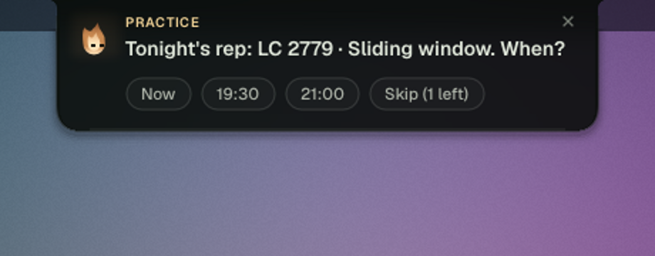
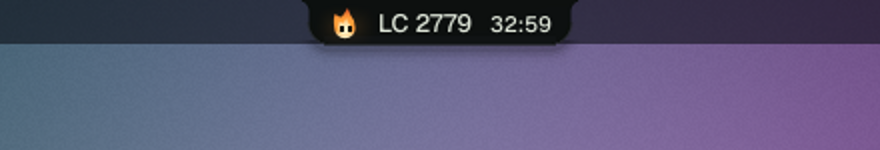
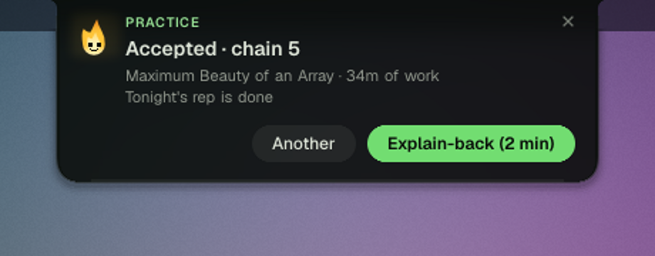
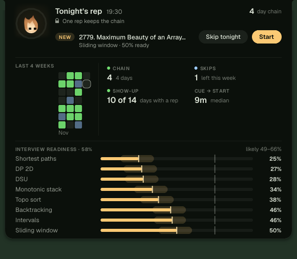

# edge

A daemon that makes competitive programming a daily habit, so you're ready for a coding interview on any day you're asked.

edge picks tonight's problem, notices when you're working on it, reads the judge's verdict as it comes in, and keeps
Claude Code locked until the day's practice is done. It does this on its own: no commands to remember, nothing to
log. You open the problem the way you already do, and edge handles the rest. It shows itself through
[Ember](https://github.com/Tejas242/ember), a dynamic island for Linux, and falls back to desktop notifications
without it.

<p align="center">
  
</p>

## What it does

**One rep a day.** The first time you open the laptop after work, one card asks when tonight's rep is. At that time
the problem is waiting. A rep counts with an accepted solution, 25 focused minutes, a submit after 15 focused
minutes, a contest you sat, or a give-up after 25 minutes. One missed day is forgiven; two in a row break the chain.
A skip token a week covers the nights you can't.

<p align="center">
  
</p>

**Interview conditions.** Each rep runs on a 45-minute countdown that only moves while you're on the problem. edge
knows you're working from the focused window (niri's event stream), saves under `~/CP` (inotify), and a terminal
whose programs run there. It asks the judge only around a submit, so verdicts show live ("judging · test 9", "WA on
test 3") and nothing is polled while you're away.

<p align="center">
  
</p>

**Readiness you can measure.** edge models each of 17 interview patterns (two pointers, sliding window, DSU, DP, …)
as a skill on the Codeforces rating scale (an Elo/IRT update after every attempt) times a memory that fades with
time and lasts longer after each spaced success. It's seeded from your Codeforces history. Readiness is the chance
you'd solve a random interview problem cold in 45 minutes, shown with its uncertainty. The next problem targets your
weakest important pattern at about a 70% chance of solving it: LeetCode on weekdays, Codeforces on weekends. A
pattern you're about to forget comes back as a cold re-solve. Once a week a blind "interview now?" drill checks
the model against reality (Brier score).

<p align="center">
  
</p>

**Contests.** edge follows the Codeforces, AtCoder and LeetCode calendars, holds you to the rounds you plan,
locks Claude while one is live, and turns the problems you didn't solve into upsolves with a deadline.

**The gate.** A Claude Code hook keeps Claude to your practice folder until the day's rep is done, during your
study hours only. It fails open if the judge is down. One weekly pass exists, and it can only be typed by you in a
real terminal, never by Claude.

**Trials, not guesses.** Rule changes run as dated trials with their success line and revert line set in advance
(`[trials]` in the config). Every day is recorded the same way: when you were asked, when you started, and why the
day counted.

## Install

Linux with systemd. niri gives the best work detection (other compositors fall back to coarser signals). Claude
Code is needed for the gate and the hint and explain-back skills.

```sh
go build -trimpath -ldflags='-s -w' -o ~/.local/bin/edge .
edge install          # systemd user service, Claude Code hooks, default config
$EDITOR ~/.config/edge/config.toml   # your handles under [accounts]
```

`edge install` backs up `~/.claude/settings.json` before adding its hooks. Logs: `journalctl --user -u edge`.

## Commands

You rarely need them; edge and Ember's buttons do the work.

| | |
|---|---|
| `edge status`, `edge stats` | today, the current task, the chain; `stats` is the versioned JSON Ember reads ([STATS.md](STATS.md)) |
| `edge next`, `edge start` | assign or open a problem now |
| `edge stuck`, `edge giveup`, `edge done` | a hint, the solution, an explain-back (the Claude skills in `skills/` call these) |
| `edge rounds`, `edge round lesson <text>` | the contest plan, a round's lesson |
| `edge config [init]` | show or write the config |
| `edge pass` | the weekly pass, from a real terminal only |

## How it's built

One dependency-free Go binary. The daemon steps on events (window focus, file saves, a gather landing) and
ticks every 20 s while a task is active, 60 s otherwise. Network calls run off the loop, one at a time, with
per-site backoff. State is one JSON file with fsync'd atomic writes, an hourly backup and automatic recovery. The
gate hook is lock-free and read-only, recovers from panics, and always exits 0. Ember and edge speak the protocol in
[CONTRACT.md](CONTRACT.md): edge pushes status and cards, Ember confirms delivery, and buttons come back as scoped
action keys that fail with a sentence instead of acting on the wrong task.

edge talks only to the judges (codeforces.com, leetcode.com, atcoder.jp, kenkoooo.com for AtCoder results) and fetches
the LeetCode rating list from zerotrac's repository on GitHub. Everything else stays on your machine.

## License

MIT
